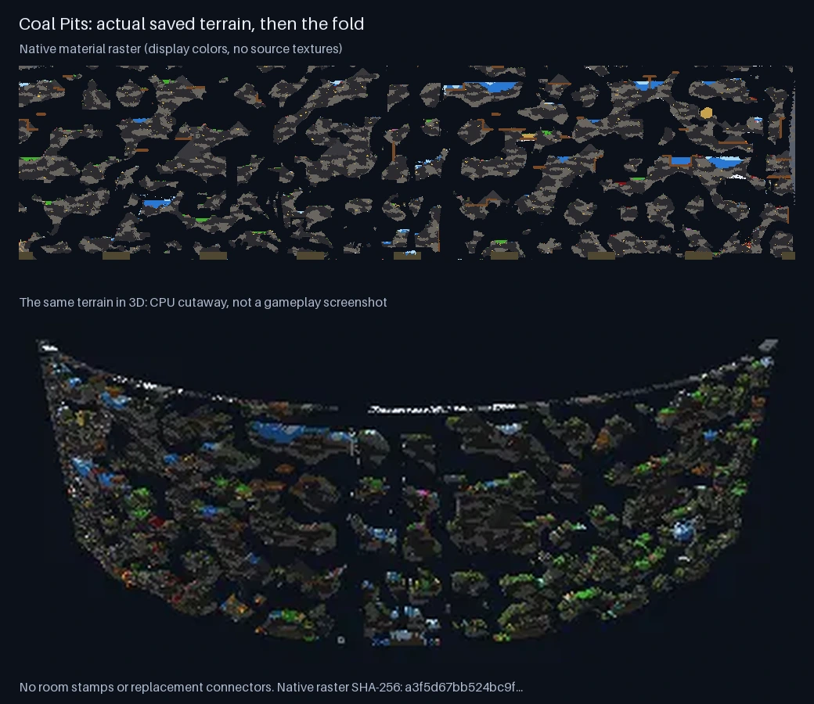

# Noita: assembled terrain folded into 3D

Descent uses actual terrain from a fresh Noita world, generated by the game itself.
It does not assemble room templates or generate replacement corridors.
The previous room-collage conversion is removed.

The crop starts in the sky above the start mountain and the giant tree, at Noita's own start.
It includes the surface, the Mines, Coal Pits, Snowy Depths, Hiisi Base, Underground Jungle, Vault, Temple of the Art, and Kolmi's arena.
Parallel worlds, distant side biomes and Temple of the Art's western side branch (x < -3072) are outside the crop.
The crop is x -3072..4144, so the folded world fits the WORLD renderer (below).

## Separate pipeline stages

| Stage | Implementation | Editable input |
|---|---|---|
| Decode saved material pixels | `tools/noita-save-decode.py` | Read-only `.png_petri` chunks |
| Select the main route | `tools/import-noita-terrain.py` | `tools/noita-terrain-source.json` |
| Map native materials to physical elements | Compiler palette | `tools/noita-terrain-materials.json`, `src/elements.js` |
| Fold the terrain into X/Z | `src/world/scenes/descent/terrainFold.js` | The source configuration's `fold` object |
| Sample the source during play | `terrainScenes.js`, `terrainRaster.js` | Native raster bands and their manifest |

Native palette IDs remain separate from physical element IDs.
Changing the bend, thickness, or material appearance does not change the native raster.
Changing the source crop changes only the selected source pixels.
The compiler produces deterministic gzip payloads with per-band hashes.

The fold bends horizontal source coordinates around a ~352-degree arc of radius 1176 cells.
The folded world must fit the WORLD renderer at default WebGPU limits: its world book (one u32 per
4-cell brick of the whole box) is one 128 MiB binding, so at 320 cells tall the box can be at most
about 2,560 cells wide. The 4128-wide 270-degree ring of 2026-10-18 overflowed it and Descent never
finished loading; `tools/check-world-fit.mjs` now fails the deploy for any World map that doesn't fit.
Source Y stays vertical. The ribbon has configurable thickness.
The inverse transform selects each voxel's original material pixel at depth 0.
Away from the middle, open space is inflated into round caves with backdrop rock behind
(docs/noita-terrain-fold-contract.md, Inflation); closed pixels hold at every depth.
The fold does not add paths, stairs, platforms, reservoirs, or room connections.

The runtime uses 256-pixel vertical cores with 32-pixel context on each side.
The last core is shorter because the source arena ends there.
All 61 resident bands remain 320 cells tall.
Native portal coordinates connect Holy Mountains without tunnels through their walls.
Portal facing follows the destination's fold tangent.
Terrain damage survives band crossings and native portals.
The cache stores changed bricks in global coordinates.
Capture freezes simulation, tools, and undo before the old window disappears.

## Source evidence

The source archive is `worlds/_archive/descent-clean-2026-10-17/world` in the mina4mac save folder.
The full path appears in `tools/noita-terrain-source.json`.
It is a vanilla new game saved on day 0, with no other mods enabled.
The `descent_flythrough` mod (in the Noita install's `mods/`) parked the player at the start and moved a free camera over x -4608..4608, y -1536..14336, waiting at each stop until `DoesWorldExistAt` reported it streamed in.
Noita then saved every chunk untouched. To make another world, enable the mod, start a New Game, wait for "Descent fly-through done", Save and Quit, archive the save, and point `world` at the copy.

The crop contains 79,165,952 selected pixels and 148 native materials.
The manifest records 312 saved chunks and their hashes.
The saved material names come from each chunk's own palette.
Numeric material IDs from another build are not substitutes.



This comparison records the initial source snapshot and default fold.
It is a geometry inspection, not an in-game screenshot.

Missing arena pixels would use the native, assembled boss arena at its XML-authored world coordinates.
The compiler does not move or arrange its pieces.
The clean source has every arena chunk, so this supplies 0 pixels.
Reserved black in these material files means air only within the documented, tested interpretation.
`black-air-regression.json` records the saved-world comparison that supports this interpretation.
Unknown colors fail compilation.

Some sky chunks just above the crop were never streamed.
Their 32 top-context rows stay `OUTSIDE`; they are never inferred as air.
`OUTSIDE` and ribbon caps are explicit conversion boundaries, not native terrain.

## Rebuild

Requirements: Python 3, NumPy, Pillow, and Node.
The browser needs no new dependency.

From the task worktree, run:

```sh
python3 -B tools/import-noita-terrain.py \
  --world /path/to/archived/world \
  --wak /path/to/Noita/data/data.wak
NOITA_DECODER_PATH=tools/noita-save-decode.py python3 -B tools/import-noita-terrain-test.py
node scripts/check-noita-fold.mjs
node scripts/check-noita-materials.mjs
node scripts/check-terrain-source.mjs
node scripts/check-terrain-raster.mjs
node scripts/check-terrain-handoff.mjs
node scripts/check-terrain-edits.mjs
node tools/descent-thumb.mjs
npm run build
node tools/check-local-map-build.mjs
```

The compiler writes `public/local-maps/noita-terrain/` and the small runtime manifest `src/world/scenes/descent/terrainRoute.json`.
The old `import-noita-map.py` command delegates to this compiler.
It no longer constructs geometry.

For a fold change, edit the `fold` object and rebuild.
For a material change, edit the explicit mapping or element definition and rebuild.
Unchanged native bands keep their hashes.
The source archive and installed game files remain read-only.

## Validation and limits

The independent archive check compares all 98,777,856 published saved-source cells, including overlapping context.
Every native material name matches.
The fixed-source check compares any published fallback cells against the original arena files; the clean source needs none.
The CPU source check tests full 3D body clearance at debug starts and every portal destination.
The 60 overlapping band pairs contain identical native bytes.
Fold tests cover inverse round trips, caps, unchanged source data, and conservative empty-column culling.

The run starts where Noita starts the player: standing on the moss at (227.5, -76).
Holy Mountain arrivals remain airborne, as in the source; the compiler adds no floor beneath them.
Hazardous bottom bands are streaming regions, not independent safe starts.

Physical elements approximate Noita material behavior.
The native bulk rock types have opaque, static physical equivalents.
Saved per-pixel color overrides, rigid-body geometry, entities, background art, and scripts are not reconstructed.
There are no fabricated loot quotas or replacement shops.
Kolmi's arena is present. Kolmi's boss AI is not.

See [the geometry contract](noita-terrain-fold-contract.md) and [the decoder format](noita-save-decoder.md).
