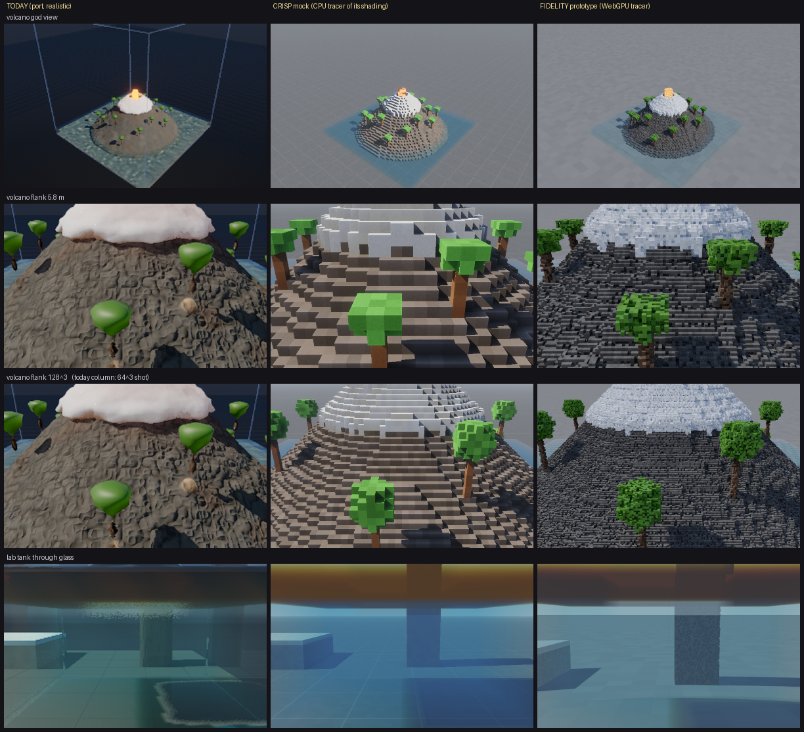

# Powder Toy 3D v2, on one page

**This is a rebuild, not a port.** You said today's game is a draft full of bugs and slop. The four audits agree:
the look, the water, the physics and the frame cost all come from models that were patched rather than fixed. v2
keeps only the engine room that works: the WebGPU foundation, the app shell, sleeping, editing, determinism, and the
world generator and element list as content. Everything you see and feel is designed from scratch.

**Direction: crisp blocks on a lean engine.** Two independent judges, one looking as a player and one as a GPU
engineer, reached this design from opposite ends.

## What it will look and feel like

- **Every cell is a block you can read.** Each cell takes one of its element's colour tones (like TPT's per-particle
  colour jitter), so you can tell sand, salt and gunpowder apart at a glance. Up close, each face is 16×16 pixel art
  at Minecraft's density: grains, planks, ore flecks, lava crust with glowing cracks, and leaves you can see through.
  Sun shadows are sharp, every crease gets soft corner shading, and light works like Minecraft's: lava lights a cave
  orange and a torch lights a room. One sky is both the backdrop and the light source. There's no clay look, no
  shimmer, and no 2-second settle after you move the camera: each frame is final the moment it's drawn.
- **Water acts like water.** It rises flat in a tank and finds its level through pipes and U-bends. A hole in a wall
  throws one arcing jet at the right speed. A spill spreads into a puddle with an edge, then stops. Mud, slime and
  lava hold slopes. Splashes throw up a crown and settle, every liquid can foam, and anything under water is tinted by
  how deep it is.
- **Things move honestly, on one clock.** A falling slab stays a slab, and a throw lands where you aimed it. Sand,
  flour and gravel each pile at their own angle, then stop. A flame lights wood in a second or two, flames lick off
  burning faces, and smoke pools under the ceiling. A charge blows a round crater with a rim of thrown debris, walls
  shield whatever is behind them, and the pressure view shows the shock crossing the room. Gold nuggets no longer
  punch through steel.
- **It stays The Powder Toy.** You can still paint every element as cells, gases and FIRE included. The heat,
  pressure, flow and X-ray views stay, and two things are new: a cutaway view, and a "crunch" style toggle that copies
  Cruelty Squad's low-res look and doubles as the cheapest phone mode.

*Left: today. Middle: the block shading v2 builds on. It's a mock made before any art pass, so the grey void and
default colours are placeholders. Right: a ray-traced alternative we're not taking.*

## The 5 biggest changes

1. **Draw the cells' faces instead of raymarching blurred clay.** A GPU mesher rebuilds faces only where cells
   changed, like Minecraft's chunk meshes. Edges are smoothed by 4× MSAA instead of TAA. This is the cheapest kind of
   drawing on Apple's GPUs.
2. **One lighting model for everything.** It combines a sun shadow map, sky light and block light stored per cell
   (so nothing leaks through 1-cell walls), corner shading, one sky and one glow function. Nothing in it is noisy.
3. **Liquids get pressure and real levels.** Each cell holds how full it is, and water flows through each face.
   Prototyped already: a U-tube levels within 2 cm, every spill and partial layer comes to rest, and no water is lost
   or created. **Anything flying is a particle**, as in Noita: pours, spray, throws and debris.
4. **One 60 Hz clock and three kinds of motion.** Vertical runs fall as columns, contact rules act in 2×2×2 blocks,
   and particles carry anything flying sideways. Cells no longer store a velocity, and the sim no longer runs 4 steps
   per frame.
5. **Nothing runs that you can't see.** Each rule reports when it's at rest, so heaps, puddles and smoke pools go to
   sleep. Redrawing happens only where the picture changed. A still world with a still camera costs nothing, as it
   does today.

## Expected performance

These are estimates. We measure them on your Mac and iPhone before we commit.

| | today | v2 |
|---|---|---|
| MacBook Pro M5, busy lab | 18–28 ms a frame (36–55 fps) | ~2 ms: 120 Hz, GPU mostly idle |
| iPhone 17 Pro Max | ~20–35 fps (est.), cut-down look | ~3–4 ms: locked 60 Hz, same look as the Mac, ~1–1.5 W |
| GPU memory at 128³ | 408 MB at boot, 600+ MB after 3 strokes | ~150–230 MB Mac, ~120–170 MB iPhone |
| settled world, still camera | nothing (kept) | nothing |
| shader code per session | ~1.7 MB, including a 5,400-line view shader | ≤ 400 KB, no shader over 700 lines |

## How we get there

Every phase ships, and each one is judged side by side against today's game.

| | phase | what you'll see |
|---|---|---|
| wk 0 | The ruler | nothing yet: the side-by-side tool, the action-shot list, outcome tests, and a 2-minute iPhone speed test |
| P1 | New look on today's physics, behind `?engine=v2` until you pick it | the block world, light, sky, water optics, smoke and flames, and a frame about 2× faster |
| P2 | New physics and water v0 | honest falls, heaps that rest, pressure-driven water, fire that spreads by touch, crisp craters |
| P3 | Water, all of it | waves, dam breaks, splashes, foam, swimming |
| P4 | Air, fire and blasts | shock waves, sealed vessels, vacuum, wind carrying smoke and sand |
| P5 | Worlds and the phone | the island and levels on the new engine, a 30-minute iPhone soak test, the old engine deleted |
| P6 | Extras that fit the phone budget | for example smoother airborne water, bounce light, Mac-only reflections if you want them |

## What we need from you

1. **A yes on the direction (blocks).** The real gate is P1's side-by-side sheet. If you still prefer today's look,
   we stop there.
2. **Pick the look on the art sheet in P1:** sky, ground, palettes, patterns, edge bevel and fire.
3. **Watch the motion sheet in P2 and pick gravity and box-mode speed.** The proposal is TF2's 2 g everywhere, with
   the god view running at 2× speed.
4. **Sign off the kill list:**
   - the plain view goes;
   - the Whitewater and detail switches go, because foam is simply always on;
   - radial gravity and loop edges move to P6.

The full design is in `v2.md`.
